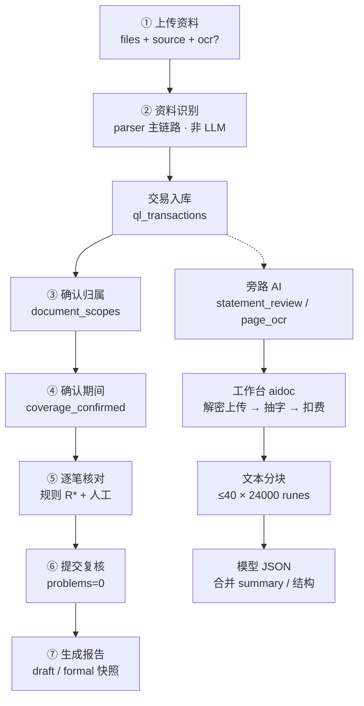

# 19 · AI 全链路运作图与字段清单

> 日期：2026-11-10  
> 范围：清流 `qingliu-workspace` + 工作台 `不加班智能团后端/internal/aidoc`  
> 配套：设计计划 [`计划-AI全流程融入与百页解析.md`](计划-AI全流程融入与百页解析.md)、测试表 [`测试表-AI全流程与百页解析.md`](测试表-AI全流程与百页解析.md)  
> 交互版：Cursor Canvas `qingliu-ai-full-flow-map.canvas.tsx`（对话旁打开）

**一句话心智**

- 实线主链路：上传识别 → 归属 → 期间 → 核对 → 提交 → 报告（交易数字以人工为准）。
- 虚线旁路：AI 辅助分析（意见 JSON，不改交易、不签发）。
- **识别完成 ≠ AI 成功**。

---

## 1. 全链路脑图



### 1.1 各步 AI 能不能掺和？（现状）

| 步骤 | 主执行者 | AI 现状 | 产出字段 |
| --- | --- | --- | --- |
| ① 上传 | 清流 HTTP | 不调模型 | pending 文件 + `ql_jobs.kind=upload` |
| ② 识别 | `parser.go` | 永不自动打模型；可选本机 OCR | `ql_documents` + `ql_transactions` |
| ③ 归属 | 人工 | 无 | `fields.document_scopes[*]` |
| ④ 期间 | 人工 | 无 | `coverage_confirmed` + `web_period` |
| ⑤ 核对 | 规则 R01–R15 + 人工 | 旁路意见不写 `review_label` | `auto_label` / `rule_id` / `reason` |
| ⑥ 提交 | 人工 | 无 | `ql_submissions` |
| ⑦ 报告 | `report.go` 快照 | AI 摘要不进金额公式 | `ql_reports` 文件快照 |
| 旁路 AI | `ai_analysis` → aidoc | `statement_review` / `page_ocr` | `ql_ai_analyses.result` JSON |

### 1.2 实锤上限（摘录）

| 项 | 值 | 位置 |
| --- | --- | --- |
| 每批上传 | 1–10 份 | `server/main.go` |
| 单份 / 整批 | ≤30MB / ≤64MB | `main.go` |
| PDF 页 | 1–500 | `parser.go` |
| 核对分页 | **每页 50 笔** | `main.go` + `ReviewStep.jsx` |
| 清流 AI 等待 | 10 分钟 | `ai_analysis.go` |
| 工作台分析超时 | 20 分钟 | aidoc `run()` |
| 文本分块 | 24000 runes / 重叠 400 / **最多 40 块** | `aidoc/domain.go` + `chunk.go` |
| 视觉并发 | `OCRVisionBatch=2` | `aidoc/ocr.go` |
| 分析槽 | 全局最多 2 | `aidoc/application.go` |

---

## 2. 表 A · 当前（改版前实装）：AI 插在哪

| 环节 | AI 插入点 | 触发 | 输入 | 输出 | 是否改主数据 |
| --- | --- | --- | --- | --- | --- |
| 资料识别 | 无模型 | 上传 job | PDF/CSV/XLSX 字节 | 交易行 + `meta.status` | 写交易（权威） |
| 本机 OCR | tesseract（非 LLM） | 上传勾 `ocr=true` | 缺字页渲染图 | 补文字再解析 | 写交易 |
| 智能解析 | `statement_review` | 面板「开始分析」 | 原件解密→抽字→≤40 块文本 | `result.summary` / 结构数组 | 否（仅意见） |
| 文档 OCR 转写 | `page_ocr` | 面板选 OCR 模式 | 逐页渲染图 | 页文字写入 aidoc 文档 | 否（清流交易不自动回写） |
| 归属 / 期间 / 核对 / 报告 | 无 | — | — | — | — |

**当前旁路两个硬伤（频发）**

1. 未传 `document_id` 时只分析「最新一份」。
2. 分块 JSON 解析失败时把模型原文塞进 `summary`，前端原样展示 → 半截 JSON 墙。

---

## 3. 表 B · 优化后：AI 应插在哪

| 环节 | AI 优化插入 | 怎么触发 | 输入字段 | 输出怎么用 | 硬约束 |
| --- | --- | --- | --- | --- | --- |
| ② 识别后 | 缺字页「视觉补全」报价 | 用户确认积分后 | `document_id` + `page_nos[]` | 回写该页文字→可选重解析交易 | 确认后才扣；可取消 |
| ③ 归属 | 持有人/关系建议 | 识别成功后可选 | 文档抬头文本片段 | 预填 `holder`/`relationship`，人工确认 | 不自动确认归属 |
| ⑤ 核对预审 | 逐笔 `ai_label`/`confidence` | 选中文档或多文档 | 交易子集 + 原文定位 | 高置信可默认采纳但可撤销；低置信进疑点 | 不签发；大额/重复必进疑点 |
| ⑤ 定位 | 跳到 `transaction_id` / 原页 | 点异常条 | `evidence.page` + locator | 打开对照原件 | 证据必须可点开 |
| ⑦ 报告 | 风险备忘（非金额） | 签发前可选附 | 已确认汇总 + AI 备忘 | 单独区块；金额仍人工 | 禁止改公式数字 |
| 旁路智能解析 | 必选文档 + 健壮 JSON | 显式选文档 | `document_ids[]` | 结构化 Tab；失败可重试 | 禁止默默只跑最新一份 |
| 分段 | 超 MaxChunks 续跑/明示 | 长文 | chunk index/pages | 覆盖提示「仅前 N 段」或续跑 | 禁止静默丢尾 |

对齐计划文档 P0.5–P6；正式报告数字仍以人工确认为准。

---

## 4. 字段契约

### 4.1 主链路交易字段（清流权威）

| 字段 | 含义 | 来源 | 谁写 |
| --- | --- | --- | --- |
| `id` | 交易主键 | `insertParse` | 清流 |
| `document_id` | 所属资料 | 上传解析 | 清流 |
| `source` | 来源枚举 | 上传 form `source` | 用户选 |
| `date` / `time` | 记账日时 | 表头映射 | parser |
| `income` / `expense` | 分厘整数 | 列或 direction | parser/domain |
| `direction` | `income` \| `expense` \| `neutral` | 规范化 | domain |
| `counterparty` / `memo` / `account` | 对手/摘要/账号 | 原件列 | parser |
| `fingerprint` | 去重指纹 | 账号+流水号或金额组合 | store |
| `duplicate` | 是否撞指纹 | 同客户已有指纹 | store |
| `auto_label` / `rule_id` / `reason` | 规则初判 | `classify` R* | domain |
| `review_label` | 人工核对 | `POST /review` | 人工 |
| `scope_excluded` | 归属未纳入 | `document_scopes.include` | 归属步骤 |

说明：表里「宽松口径陌生进账，未核实 · **R12**」是规则引擎（`domain.go`），**不是** AI。

### 4.2 上传 / Job payload

| 键 | 示例 | 用途 |
| --- | --- | --- |
| `files` | multipart 1–10 | 原件 |
| `source` | `wechat_statement` / `bank_statement` / … | 解析方言 |
| `ocr` | `true` \| `false` | 本机 tesseract |
| `batch` | ≤64 字符 | 断网幂等回放 |
| `job.payload` | `{id,name,sha,source,ocr}` | worker 解析 |

### 4.3 喂给 AI 的契约（工作台 aidoc · `statement_review`）

**System**

```text
你是银行流水核对助手。只输出 JSON；金额以原文为准；不得编造；不得给出授信结论。
```

**User（每块）**

```text
以下是同一份资料的第 i/N 段（第 a-b 页）。只根据本段文字输出 JSON。
{"summary":"…","income_structure":[{"source","amount","evidence"}],"anomalies":[{"item","evidence"}],"questions":["…"],"disclaimer":"AI 辅助，需人工复核"}
资料：
«chunk.Text»
```

### 4.4 AI 合并后 `result`（存 `ql_ai_analyses.result`）

| 字段 | 类型 | 前端怎么用 |
| --- | --- | --- |
| `summary` | string（多段 `[第x页]` 拼接） | `ai-summary`；解析失败会变 JSON 原文 |
| `income_structure[]` | `{source,amount,evidence,page?}` | 完整结果 Tab |
| `anomalies[]` | `{item,evidence,page?}` | 异常点 Tab |
| `questions[]` | string \| 对象 | 建议核实 Tab |
| `coverage` | `{pages_total,chunks,…}` | 内部诊断 |
| `disclaimer` | string | 灰字提示 |

### 4.5 清流 AI 任务表

| 表/字段 | 含义 |
| --- | --- |
| `ql_ai_analyses.id` | 清流分析单 |
| `document_id` | 分析哪份资料 |
| `workbench_document_id` / `workbench_analysis_id` | 工作台侧 ID |
| `status` / `stage` / `progress` / `error` | 排队→上传→运行→done/failed |
| `result` | 合并后的 JSON |
| `ql_jobs.kind=ai_analysis` | worker 执行载体 |

---

## 5. 长文件怎么分段喂模型

| 步骤 | 规则 | 代码 |
| --- | --- | --- |
| 1. 按页 | `pdftotext` 用 form-feed (`\f`) 分页 | `extract.go` / `chunk.go` |
| 2. 攒块 | 多页拼到 ≤ **24000** runes 再 flush | `ChunkMaxRunes` |
| 3. 超长单页 | 按窗口切，重叠 **400** runes | `ChunkOverlapRune` |
| 4. 截断 | 块数 > **40** → 只留前 40（尾页可能丢） | `MaxChunks` |
| 5. 串行调用 | 每块一次 `ExecuteChatBilled` | `application.go` |
| 6. 合并 | `mergeChunkResults`：摘要加 `[第a-b页]`，数组 append | `chunk.go` |
| 7. 解析失败 | `parseModelJSON` 失败 → `summary=模型原文` → UI 变 JSON 墙 | `application.go` + `AIAnalysisPanel.jsx` |

**`page_ocr` 另一条路**：不走文本块；逐页渲染 DPI=200；视觉模型每页一次；`OCRVisionBatch=2`。清流交易默认不自动回写（优化表 P2 才计划写回）。

清流超时 10min vs 工作台 20min：长文可能台还在跑、清流已失败。

---

## 6. 代码清单（去哪改）

### 6.1 清流 · 识别与主链路

| 能力 | 入口/文件 | 关键符号 |
| --- | --- | --- |
| 上传排队 | `server/main.go` `POST …/upload` | `files` / `source` / `ocr` / `batch` |
| 单 worker | `server/worker.go` | `GET_LOCK` + `runOne` |
| **识别总入口** | `server/parser.go` | **`parseFile`** |
| PDF 页解析 | `parser.go` | `parsePage` / `mupdfPages` / `localOCRPage` |
| 入库 | `server/store.go` | `insertParse` |
| 规则打标 | `server/domain.go` | `classify` / `evaluate`（含 R12） |
| 归属/期间/核对/提交/报告 | `server/main.go` | `ownership` / `coverage` / `review` / `submit` / `report` |
| 问题清单 | `server/store.go` `data()` | `problems[]` |
| 报告快照 | `server/report.go` | PDF / XLSX / HTML |
| 解析计费 | `server/pricing.go` | `chargeParse` text/ocr/vision |
| 核对分页 UI | `frontend/.../ReviewStep.jsx` | `page * 50 < data.row_count` |

### 6.2 清流 · AI 旁路

| 能力 | 文件 | 符号 |
| --- | --- | --- |
| 开始/轮询 | `server/ai_analysis.go` | `startAIAnalysis` / `runAIAnalysisJob` |
| 解密上传工作台 | `server/workbench.go` | `wbUploadDocument` → `Store.read` |
| 前端面板 | `frontend/src/features/ai-analysis/AIAnalysisPanel.jsx` | `summary` 直出 / 完整结果 Modal |

### 6.3 工作台 · aidoc

| 能力 | 文件 | 符号 |
| --- | --- | --- |
| 上传抽字计费 | `internal/aidoc/application.go` | `CreateDocumentBilled` / `chargeDocument` |
| PDF 抽字 | `internal/aidoc/extract.go` | `Extract` / `runText`（stdout-only） |
| 分块 | `internal/aidoc/chunk.go` | `splitIntoChunks` / `mergeChunkResults` |
| 分析运行 | `application.go` | `run` / `MaxChunks` / `slots=2` |
| 视觉 OCR | `internal/aidoc/ocr.go` | `OCRVisionBatch=2` |
| JSON 解析 | `application.go` | `parseModelJSON` |

---

## 7. 频发坑（系统性，非偶发）

| 现象 | 根因 | 频发条件 | 算不算坏 |
| --- | --- | --- | --- |
| 第 4 页 / 163 笔「下一页」灰 | 每页 50；4 页已是末页；文案不写「共 4 页」 | 笔数 >50 必现误解 | 功能正常；文案差 |
| AI 结果像 JSON 且不全 | 分块 JSON 解析失败→原文进 summary；前端直渲染 | 微信长账单多块时高发 | **产品缺陷** |
| 表里 R12「宽松口径…」 | 规则引擎 `classify`，不是 AI | 陌生进账默认 | 正常 |
| 多文件 AI 只跑最新 | `document_id` 空则 `LIMIT 1` | 一批多份后点分析 | **产品缺陷** |
| 识别完成但 AI 失败同屏 | 两条管道互不覆盖 | 鉴权/积分/模型问题 | 架构正确但需拆文案 |
| 超 40 块丢尾 | `MaxChunks` 截断 | 百页高密度文字 | 静默不全 → 要优化 |

---

## 8. 修订记录

| 日期 | 说明 |
| --- | --- |
| 2026-11-10 | 首版：脑图、当前/优化两表、字段契约、分段、代码清单、频发坑；同步 Canvas |
