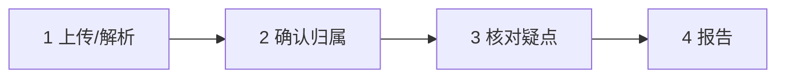

# 计划 · AI 全流程融入与百页解析拿捏

> 状态：设计稿（产品阶段 P0.5+ 未开工）+ **本机旁路 AI 阻塞修复已验证**  
> 日期：2026-11-10  
> 范围：清流 `qingliu-workspace` + 工作台 `不加班智能团后端/internal/aidoc`  
> 测试夹具：`.local/fixtures/decrypted-pdfs/`（真实客户料，已 gitignore）  
> 本机修复（2026-11-10）：`aidoc.runText` 只用 stdout + `ToValidUTF8`；`chargeDocument` 补 `BatchTraceID`；清流 `wbUploadDocument` 先 `Store.read` 解密再上传。复测微信 9 页 AI → `done`，积分 9899→9894。  
> 产品口径（已确认）：
>
> 1. 视觉/模型 OCR：**文字层与本机 OCR 失败后，弹预估积分，用户确认才跑**
> 2. AI 预打标：**只建议**；高置信可默认采纳但必须一键可撤销；冲突/低置信必进疑点
> 3. 正式报告数字：**仍以人工确认为准**；AI 不签发、不改金额
> 4. **重新识别**：**覆盖**该文档旧交易后按新结果重写（纠错优先；须二次确认）
> 5. **重新分析**：AI 失败可对**指定文档**再跑，不必重传 PDF；多文件必须显式选择，禁止默默只跑最新一份

配套测试表见同目录 [`测试表-AI全流程与百页解析.md`](测试表-AI全流程与百页解析.md)。  
运作脑图 / 字段契约 / 当前·优化对照表见 [`19-AI全链路运作图与字段清单.md`](19-AI全链路运作图与字段清单.md)（交互版 Canvas：`qingliu-ai-full-flow-map`）。

---

## 0A. 界面懵点澄清（上传区 vs 识别完成 vs AI 失败）——必须先懂再改

用户截图里同时出现三块，**不是同一件事**，现在 UI 把它们叠在一页，所以会懵。

```text
┌─────────────────────────────────────────────────────────┐
│ ① 上传区（永远可再选文件）                                 │
│    「上传并开始识别」= 再交一批原件进解析队列               │
├─────────────────────────────────────────────────────────┤
│ ② 已上传列表 FoldPanel「识别完成」                         │
│    = 这份 PDF 的「资料识别」已结束，交易已入库               │
│    ≠ AI 辅助分析成功                                      │
├─────────────────────────────────────────────────────────┤
│ ③ 右下角「后台任务」                                        │
│    可同时有：资料识别 / AI 辅助分析 / 报告生成               │
│    其中一条 AI 失败，不影响 ② 里已识别完成的文档             │
└─────────────────────────────────────────────────────────┘
```


### 0A.1 两套管道（代码事实）


|         | **资料识别**（主链路）                           | **AI 辅助分析**（旁路）          |
| ------- | --------------------------------------- | ------------------------ |
| 触发      | 上传区「上传并开始识别」                            | AI 面板「开始分析」或报告页入口        |
| 任务 kind | `upload`                                | `ai_analysis`            |
| 成功文案    | 文档徽章「识别完成」；任务「资料识别 · 识别完成，请确认资料归属」      | 分析记录 status=done         |
| 失败重试    | 任务列表对 `kind=upload` **且 failed** 显示「重试」 | **任务列表没有 AI 重试按钮**（见下）   |
| 产出      | `ql_documents` + `ql_transactions`      | `ql_ai_analyses` 意见 JSON |
| 和对方关系   | **互不覆盖**：AI 挂了，识别结果仍在                   | 识别失败时通常也没什么可分析           |


截图里「识别完成」+「AI 辅助分析 · 操作账号已失效或没有客户权限 / 失败」可以**同时成立**：129 页、2549 笔已经进库；AI 只是工作台鉴权/权限挂了，**不等于识别作废**。

### 0A.2 「上面还能上传」和「下面识别完成」冲不冲突？

**不冲突。**  
上面是「再加资料」入口；下面是「本客户已入库的资料档案」。  
同一客户本来就可以多份（微信+银行+支付宝），上限仍是每批 1–10 份。

唯一硬冲突（代码）：

- 再传**内容完全相同**的文件（同 SHA）→ 拒绝「重复文件」  
- 客户仍有 `queued/running` 任务且未超 30 分钟 → `busy`，其它写操作会挡


### 0A.3 能不能「重新解析」？


| 场景                              | 现状（代码）                         | 计划应改成                                                                                               |
| ------------------------------- | ------------------------------ | --------------------------------------------------------------------------------------------------- |
| 上传任务失败，原件**未**落入 `ql_documents` | 任务「重试」可再入队                     | 保留；文案写清「仅识别失败可重试」                                                                                   |
| 已「识别完成」，想再跑一遍同一文件               | **不能**同 SHA 再传；没有「对已成功文档一键重解析」 | **P0.7**：文档行「重新识别」→ **覆盖**该 `document_id` 下旧交易与 meta，重新入队 `upload` 解析；二次确认文案必须写清「将清空本份已解析交易与相关人工标记」 |
| 格式错了要换文件                        | 改文件后重新上传（SHA 变了）               | UI 提示「请上传更正后的原件」                                                                                    |
| 只要视觉补无字页                        | 走 AI/`page_ocr`，不是重传           | 文档行「需视觉识别时」出确认报价按钮                                                                                  |


### 0A.4 AI 分析失败后能不能再分析？


| 现状                                                               | 计划                                             |
| ---------------------------------------------------------------- | ---------------------------------------------- |
| 失败原因如「操作账号已失效或没有客户权限」= 工作台 token/权限问题，**不是 PDF 坏了**              | 失败条展示：原因分类（登录失效 / 积分不足 / 模型错误）+ 动作             |
| 任务列表**只对 upload 失败给重试**；`ai_analysis` 失败无重试按钮                    | **必须**给 AI 失败「重新分析」→ 再调 `POST .../ai-analysis` |
| 面板可再次点「开始分析」：失败终态不占复用；仅 `queued/running/uploading` 且 30 分钟内会复用旧单 | 文案写清「可再次开始」；登录失效引导重新登录工作台账号                    |
| 未传 `document_id` 时默认分析**最新一份**文档                                 | **见 0A.5**——多文件时这是大坑                           |


### 0A.5 一次上传多份时，AI 现在怎么做？（实锤）

```text
用户一次传 3 份（微信、工行、支付宝）
  → 产生最多 3 条 upload 任务，清流单 worker 串行识别
  → 每份各自「识别完成」，列表出现 3 个 FoldPanel

用户点「AI 辅助分析」且请求体不带 document_id
  → 代码只取 ORDER BY created DESC LIMIT 1
  → **只分析最新那一份**，另外两份默默不跑
```

证据：`main.go` `POST /api/clients/{cid}/ai-analysis`：

- `document_id` 空 → `SELECT id FROM ql_documents ... ORDER BY created DESC LIMIT 1`

**计划（多文件 AI 必须改成可理解）：**

1. **按份选择**：分析前必选文档（多选或逐份）；默认勾选「未分析过的成功文档」。
2. **排队执行**：选中 N 份 → 入 N 条 `ai_analysis`（或一条父任务带子任务）；受 aidoc `slots=2` + 清流单 worker 约束，UI 显示「第 i/N 份」。
3. **禁止默默只跑最新一份**；若只跑一份，标题必须出现文件名。
4. **预审（P3）**应对「本客户全部成功交易」跑，而不是只对最新 PDF 原文。
5. 批次上限仍遵守：上传 1–10 份；AI 可对已上传列表里更多历史文档再选，但并发仍受槽位限制。


### 0A.6 推荐信息架构（解决「一脸懵」）


| 区域     | 只放什么                                        | 禁止               |
| ------ | ------------------------------------------- | ---------------- |
| 步骤条旁状态 | 「识别：x 成功 / y 失败」「AI：a 成功 / b 失败 / c 未跑」     | 一个「完成」糊弄全部       |
| 上传区    | 仅新增原件                                       | 不显示 AI 成败        |
| 文档行    | 识别状态 + 页/笔/期间 + 操作：确认归属入口、重新识别、AI 分析此份、视觉补全 | 与全局 AI 混成一句      |
| 后台任务   | 按 kind 分组着色；失败动作分叉（识别重试 / AI 重试 / 重新登录）     | AI 失败只显示「失败」无下一步 |


用户心智一句话：

> **识别完成 = 流水已经拆成交易，可以去确认归属。**  
> **AI 分析 = 额外助手意见，失败了不影响已识别的交易；修好账号后可以再点分析。**

---


## 0. 代码实锤上限（禁止臆造）

下列数字全部来自当前仓库源码 / 迁移，**不是假设**。设计与测试必须以它们为基线；若要改上限，必须先改代码与配置，再改本文。

### 0.1 清流（`qingliu-workspace/server`）


| 项              | 确切值                                                  | 代码位置                                            |
| -------------- | ---------------------------------------------------- | ----------------------------------------------- |
| 每批上传文件数        | **1–10 份**                                           | `main.go`：`len(files) >= 1 && len(files) <= 10` |
| 单份大小           | **≤ 30MB**                                           | `main.go`：`30<<20`                              |
| 整批大小           | **≤ 64MB**                                           | `main.go`：`MaxBytesReader(..., 64<<20)`         |
| PDF 页数         | **1–500 页**                                          | `parser.go`：`count < 1                          |
| 原页预览页号         | **1–500**                                            | `parser.go`：`page < 1                           |
| 后台执行器          | **全进程单 worker**（`GET_LOCK('qingliu:worker')`）        | `worker.go`                                     |
| 同客户互斥          | 有 `queued/running` 且未超 **30 分钟** → `busy`，写操作 409    | `store.go`：`staleJobMinutes = 30`               |
| AI 分析等待超时（清流侧） | **10 分钟**                                            | `ai_analysis.go`：`aiAnalysisTimeout`            |
| 交易列表分页         | **每页 50 笔**                                          | `main.go`                                       |
| 客户列表分页         | **每页 20 条**                                          | `main.go`                                       |
| 解析路径           | 文字层 → 本机 tesseract 逐页 → 标 `needs-vision`（**不自动打模型**） | `parser.go`                                     |
| 主链路交易入库        | 规则 `classify` + 指纹 `fingerprint` 判重                  | `domain.go` / `store.go`                        |


### 0.2 工作台 aidoc（真正跑模型的一侧）


| 项                     | 确切值                                                    | 代码位置                                       |
| --------------------- | ------------------------------------------------------ | ------------------------------------------ |
| 文本提取页上限               | **默认 500**（`AI_DOC_MAX_PAGES`，缺省 500）                  | `config.go` / `aidoc.DefaultMaxPages`      |
| 视觉 OCR 页上限            | **默认 500**（`AI_DOC_MAX_OCR_PAGES`，缺省 500）              | `config.go` / `DefaultOCRPPageLimit`       |
| **一次并发识别几页图**         | `OCRVisionBatch = 2`                                   | `aidoc/ocr.go`                             |
| 渲染 DPI                | **200**                                                | `OCRPageRenderDPI`                         |
| 单页渲染超时                | **90s**                                                | `renderSinglePage`                         |
| 分析任务全局并发槽             | `slots = make(chan struct{}, 2)` **→ 同时最多 2 个分析**      | `aidoc/application.go` `NewApplication`    |
| `statement_review` 分块 | 每块 **24000 runes**，重叠 **400**，**最多 40 块**（超出截断尾部）      | `ChunkMaxRunes` / `MaxChunks`              |
| 分析任务超时                | **20 分钟**                                              | `run()`：`WithTimeout(..., 20*time.Minute)` |
| 上传文档大小                | **≤ 30MB**                                             | `CreateDocumentBilled`                     |
| 缺字页本机补 OCR（提取阶段）      | **逐页串行** tesseract，不是视觉 batch                          | `extract.go`                               |
| `page_ocr` 计费形态       | **每页一次模型调用**；峰值内存 ≈ 2 张图                               | `ocr.go` 注释与实现                             |
| 解析计价种子                | text **1/份**，ocr **1/页**，vision **5/页**（运营可改）          | migration `000061`                         |
| `doc-parse`           | 按次（与页数无关）                                              | `ServiceCodeDocParse`                      |
| 装配                    | `MaxPages = max(env, 500)`；`MaxOCRPages = max(env, 1)` | `cmd/server/main.go`                       |


### 0.3 「100 多页」在现有系统里实际怎么跑

```text
有文字层的 129 页微信账单
  → 清流 parser 文字层提取（按份扣 text）
  → 不进 page_ocr，不占 OCRVisionBatch
  → 若再点「智能解析」：文本切块串行调模型（≤40 块），占 aidoc 2 槽之一

扫描件 / 无字页 100 页，用户确认视觉识别
  → page_ocr：每页 1 次模型；并发 2 页一批
  → 理论最少批次数 = ceil(100/2) = 50 批
  → 与「智能解析」共享全局 2 分析槽；清流侧还是单 worker 排队
```

**矛盾点（设计必须正面处理，不能装看不见）：**

1. 产品允许 500 页，但视觉是 **2 页并发 × 每页 1 次模型** → 百页必然排队，耗时长、积分高。
2. `statement_review` 有 **MaxChunks=40** → 超长文本分析会**截断尾部**，与「长流水不丢页」目标冲突。
3. 清流 **单 worker** + 工作台 **2 分析槽** → 多客户同时百页视觉会互相堵住。
4. 清流 AI 超时 **10 分钟** vs 工作台分析超时 **20 分钟** → 长任务可能工作台还在跑、清流先判失败。

---


## 1. 目标（改完用户体感）


| 之前                    | 之后                             |
| --------------------- | ------------------------------ |
| AI 在旁路写摘要，主流程仍是规则+人手  | AI **写入预审字段**，缩短疑点队列           |
| 百页视觉等于「整本逐页烧积分」且体验像卡死 | **先分流、再报价确认、再按 2 页并发跑**，进度按页可见 |
| 「智能解析」与「出交易/打标」脱节     | 视觉结果进交易；预审建议进核对；报告前附风险备忘       |


**一句话产品承诺：**  
AI 只缩短人工核对队列；最终标签与报告数字仍以人工确认为准；百页视觉必须知情确认。

---


## 2. 全流程：每个环节 AI 干什么




### 环节 1 · 上传与解析（抽交易）


| 子步骤              | 谁做                  | AI？   | 硬规则                                                         |
| ---------------- | ------------------- | ----- | ----------------------------------------------------------- |
| 收文件              | 清流                  | 否     | 仍 1–10 份/批，≤30MB/份，≤64MB/批，≤500 页                           |
| 文字层提取            | 清流 parser           | 否     | 有字就取字；按份 `parse_text_points`                                |
| 本机 OCR           | 清流 tesseract        | 否     | 无字页逐页；按页 `parse_ocr_points`                                 |
| 标 `needs-vision` | 清流                  | 否     | **禁止自动**调视觉                                                 |
| 用户确认视觉           | UI + 工作台 `page_ocr` | **是** | 弹：无字页数 × 单价预估；确认后跑；并发 **2 页/批**                             |
| 写回交易行            | 清流                  | —     | 视觉转写文本必须再走现有 parser/行抽取，**进** `ql_transactions`，不是只留在 AI 面板 |


**百页拿捏（本设计的解法，不改并发常量也能落地）：**

1. **分流**：只对 `vision_pages`（或 aidoc 判定无字页）报价，有字页零模型。
2. **确认**：展示 `页数 × vision_points_per_page` 与预估时长下限（按「每批 2 页」粗算）。
3. **执行**：沿用 `OCRVisionBatch=2`，进度 `done/total` 透传（已有）。
4. **熔断**：超过 `AI_DOC_MAX_OCR_PAGES`（默认 500）拒绝并要求拆分（已有错误码路径）。
5. **队列诚实**：清流单 worker + aidoc 2 槽 → UI 必须显示排队位，禁止假进度。

**本阶段不建议先改的常量（除非单独立项）：**  
`OCRVisionBatch`、`slots=2`——它们是按 2C/1G 写的；提并发要先做压测，不在本计划默默调大。

### 环节 2 · 确认归属


| AI 做什么                       | 权威                     |
| ---------------------------- | ---------------------- |
| 从文件名/首页/主体字段建议 `holder`、资料来源 | 仅预填；人点确认后才 `confirmed` |
| 多文档疑似同一主体时提示合并核对             | 不自动改 scope             |


### 环节 3 · 核对疑点（提效核心）

在现有 `classify` / `fingerprint` **之后**加 AI 预审（批量、可排队）：


| 字段（建议）          | 含义                                           |
| --------------- | -------------------------------------------- |
| `ai_label`      | included / excluded / pending / duplicate 建议 |
| `ai_confidence` | high / mid / low                             |
| `ai_reason`     | 一句话 + 可定位（交易 id 或页码）                         |
| `ai_status`     | none / suggested / adopted / overridden      |


**落库规则（已确认口径）：**

- 高置信且与规则一致 → 可 **默认采纳** 写入展示用标签，但 `review_label` 记为可撤销的采纳态；一键撤销回自动规则结果。  
- 低置信 / AI↔规则冲突 / 大额告警 / `duplicate=true` → **必须**进「待处理疑点」。  
- 「采纳 AI」= 写入与今日人工复核同等的 `ql_reviews` 记录（operator 标明 `ai_adopted`），保持审计。  
- AI 异常点/建议核实：**每条必须带** `transaction_id` **或页定位**；不能定位的不算完成。

**批处理拿捏（预审，不是视觉）：**

- 输入是**结构化交易行**，不是整页图 → 按笔或按块调模型，避免再烧 page-ocr。  
- 受 aidoc `slots=2` 与清流单 worker 约束：预审任务进 `ql_jobs`（新 kind 如 `ai_prelabel`），与 upload/report 同队，进度可见。  
- 单次预审请求体量需另立上限（实现时以 token/行数为准）；**不得**假定「一次塞进全部 100 页原文」。


### 环节 4 · 报告


| AI 做什么                            | 不做什么                 |
| --------------------------------- | -------------------- |
| 签发前生成「风险备忘」：未处理灰区数、Top N 高风险（带定位） | 不改 summary 金额        |
| 可选写入草稿附件/内部备注                     | 不替代正式 PDF/Excel 快照口径 |


---


## 3. 与旁路「AI 分析面板」的关系


| 现能力                         | 去留                                                        |
| --------------------------- | --------------------------------------------------------- |
| `statement_review` 智能解析     | 保留为「整份意见」；**必须修复 MaxChunks=40 截断**（见 §5）或明确 UI 提示「仅前 N 段」 |
| `page_ocr` 文档 OCR 转写        | 升格为环节 1 的正式能力入口（确认后写回交易），面板可复用同一任务                        |
| 仅展示 summary/anomalies 的散文结果 | 升级为可点击定位；无定位则降级显示并标「未绑定交易」                                |


---


## 4. 实施阶段（计划表）


| 阶段   | 内容                                                        | 依赖                             | 验收口径                             | 状态   |
| ---- | --------------------------------------------------------- | ------------------------------ | -------------------------------- | ---- |
| P0   | 文档化实锤上限 + 测试表 + **0A 界面关系澄清**                             | —                              | 研发/测试/产品对「识别≠AI」口径一致             | ✅ 本文 |
| P0.5 | **UX 拆分**：文档行状态/操作；任务失败分叉；AI 必选文档；禁止默默分析「最新一份」            | P0                             | 多文件时用户能说出「我在分析哪一份」               | ⬜    |
| P0.6 | AI 失败可「重新分析」；登录失效引导重登；任务列表支持 `ai_analysis` 重试             | P0.5                           | 截图类「账号失效」失败可恢复，不必重传 PDF          | ⬜    |
| P0.7 | 「重新识别」按**覆盖**落地：清该文档旧交易/相关 review → 重跑解析；同 SHA 引导用重识别而非重传 | P0.5                           | 确认框明示清空；重跑后笔数/期间刷新；旧人工标不残留       | ⬜    |
| P1   | 视觉确认报价 UI + 进度透传（无字页数×单价）                                 | 现有 `needs-vision` / `page_ocr` | 未确认零模型调用；确认后进度按页                 | ⬜    |
| P2   | `page_ocr` 结果写回清流交易行                                      | P1                             | 扫描件确认后 `ql_transactions` 有行，能进核对 | ⬜    |
| P3   | 交易预审字段 + 疑点队列规则 + 采纳/撤销                                   | P2 或文字层路径可并行                   | 高置信默认可撤销；冲突必进疑点；可定位              | ⬜    |
| P4   | AI 结果条跳转交易 / 批量采纳                                         | P3                             | 点异常→落到具体行                        | ⬜    |
| P5   | 报告前风险备忘                                                   | P3                             | 正式数字不变；备忘可打开                     | ⬜    |
| P6   | 修 `MaxChunks=40` 截断或诚实提示；对齐清流 10min vs 工作台 20min 超时       | 工作台 aidoc                      | 长流水分析不静默丢尾，或 UI 明示截断             | ⬜    |
| P7   | （可选单独立项）压测后再议 `OCRVisionBatch` / `slots`                  | 运维指标                           | 无压测禁止默默加大并发                      | ⬜    |


---


## 5. 必须单独立项的已知缺陷（来自代码，不是臆测）


| ID  | 问题                             | 证据                                       | 建议                             |
| --- | ------------------------------ | ---------------------------------------- | ------------------------------ |
| D1  | `statement_review` 超过 40 块截断尾部 | `chunk.go`：`chunks = chunks[:MaxChunks]` | 提高上限 / 按页续跑 / UI 明示「已分析至第 x 页」 |
| D2  | 清流 AI 等 10min，工作台跑 20min       | `ai_analysis.go` vs `application.run`    | 对齐超时或清流改为轮询到工作台终态              |
| D3  | 全局仅 2 个分析槽 + 清流 1 worker       | `slots` 容量 2；`qingliu:worker`            | UI 排队；多租户高峰限流文案                |
| D4  | 旁路 AI 不写回 `label`              | 现面板只存分析结果                                | 由 P3 解决                        |
| D5  | 未传 `document_id` 只分析最新文档       | `main.go` AI POST                        | P0.5 必选文档/多选排队                 |
| D6  | AI 失败任务无重试按钮                   | `TaskList.jsx` 仅 `kind==upload`          | P0.6                           |
| D7  | 「识别完成」与 AI 失败同屏无解释             | 上传页信息架构                                  | P0.5 文案与分区                     |


---


## 6. 明确不做

- 不自动对整本 PDF 开视觉（必须确认）  
- 不让 AI 签发正式报告或改分文金额  
- 不用 AI 替代指纹判重  
- 不引入 Redis / 第二常驻队列服务（遵守清流 AGENTS）  
- 不把真实客户 PDF 提交进 `server/testdata`  
- 无压测不擅自把 `OCRVisionBatch` 从 2 调大

---


## 7. 测试夹具映射（供测试表引用）

路径：`qingliu-workspace/.local/fixtures/decrypted-pdfs/`


| 文件                | 页数      | 主测意图                    |
| ----------------- | ------- | ----------------------- |
| `0_微信…`           | 9       | 文字层主路径；按份计费；预审          |
| `4_支付宝…`          | 6       | 同上                      |
| `1_工行…`           | 41      | 较大页数文字层；与微信撞指纹/疑似重复     |
| `2_庄海钦` / `3_杨海丽` | 32 / 11 | 归属预填；必要时视觉确认路径（勿默认全量视觉） |


**冒烟不跑全量视觉。** 百页视觉用合成或单独授权的长扫描件；本夹具最大 41 页，够验并发批次数与进度，不够代替 100+ 生产压测。

---


## 8. 变更记录


| 日期         | 说明                                                           |
| ---------- | ------------------------------------------------------------ |
| 2026-11-10 | 首版：嵌入代码实锤上限；四环节 AI 职责；P0–P7；已知缺陷 D1–D4                       |
| 2026-11-10 | 增补 §0A：识别完成 vs 上传区 vs AI 失败；重解析/重分析实锤；多文件只分析最新一份的坑；P0.5–P0.7 |
| 2026-11-10 | 产品钉死：重新识别=覆盖旧交易；AI 必须选文档；口径写入文首                              |


