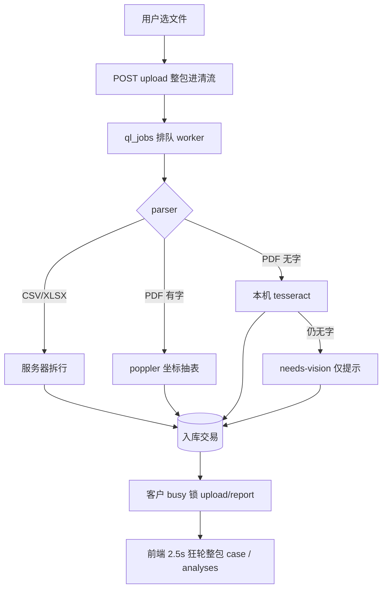
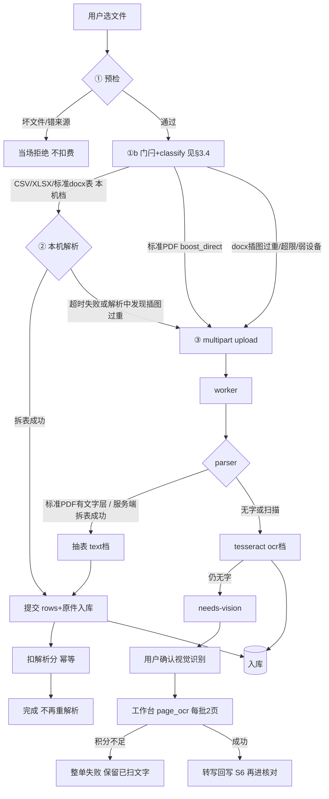
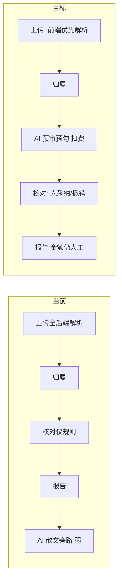
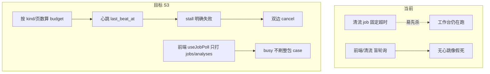
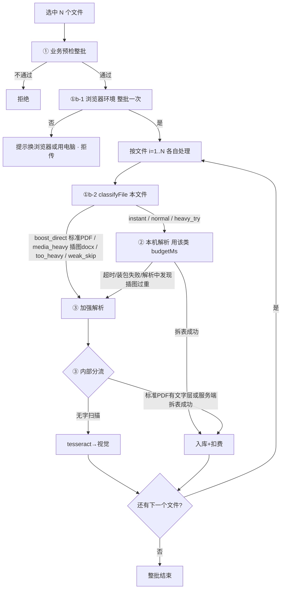
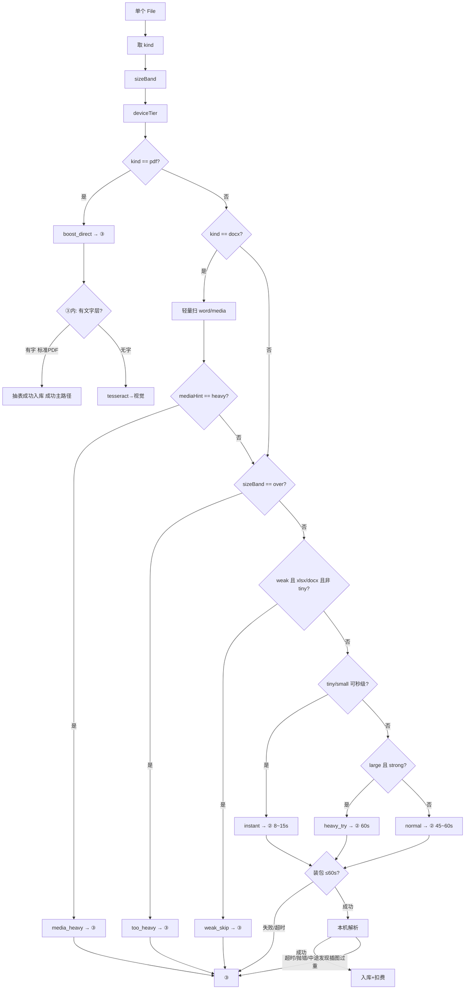
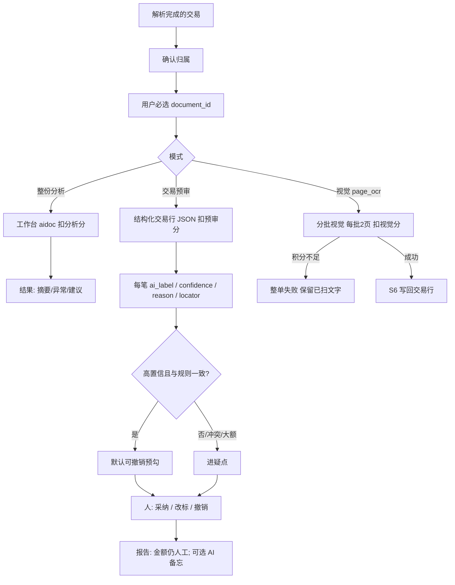

# 计划 · 清流减负与 AI 赋能总册

> **唯一实施计划** · 2026-11-11  
> 本地：[10-本地开发与测试](10-本地开发与测试.md) · 夹具 [`samples/`](../samples/) · [`scripts/api-smoke-case.ps1`](../scripts/api-smoke-case.ps1) · **全量 DoD+PDF**：[`scripts/api-smoke-full-dod.ps1`](../scripts/api-smoke-full-dod.ps1)  

> 跨仓：清流 + 工作台（`aidoc` / `page-ocr` / `doc-parse`）  
> 长任务协议（工作台）：[`不加班智能团后端/docs/plans/long-running-analysis-protocol.md`](../../不加班智能团后端/docs/plans/long-running-analysis-protocol.md)

勾选：⬜ 未做 · ◐ 进行中 · ✅ 已验收

### 进度记录

| 日期 | 阶段 | 记一笔 |
| --- | --- | --- |
| 2026-11-11 | S1 ◐ | 开工：预检/门闩/CSV 本机拆行/upload-parsed/瀑布接线/busy 改 jobs 轮询；Vitest 20 绿；Go `AcceptClientParsed` 绿。待真机联调扣费与 XLSX 夹具、AI 面板项。 |
| 2026-11-11 | S1 ◐ | AI 必选文档（前后端）；结果/导出走定位；邻页预取；XLSX 单测。Q12/Q13/Q5 代码面补齐；真机扣费与真实 AI 仍待验。 |
| 2026-11-11 | S3 ◐ | 清流 `jobPolicy(kind)`：按 kind stale/RunTimeout；sweep/busy/jobsLive 用 CASE；取消只收本 analysis；worker 按 kind 超时。工作台心跳/双边 cancel 仍待。 |
| 2026-11-11 | S3 ◐ | 工作台 aidoc：`TaskBudgetFor` + `last_beat_at`/`budget_sec`（000086）+ `POST .../cancel` + 循环 `cancels`；清流取消/超时转发工作台 cancel，识别 `cancelled`。aidoc/openapi/migration 测绿。真机长跑双边仍待验。 |
| 2026-11-11 | S5 ◐ | mammoth 瘦 docx 本机抽表；`docx-media-probe` 轻量扫 media→`media_heavy`；classify/client-parse 接线；Vitest docx 相关绿。真机入库扣费仍待验。 |
| 2026-11-11 | S2 ◐ | 交易 payload `ai_*`；`ai-suggest`/`ai-adopt`/`ai-revoke` + 审计；核对表展示与一键采纳/撤销；分析完成可「写入核对预勾」。真实模型带 transaction_id 仍待验。 |
| 2026-11-11 | S6 ◐ | page_ocr 结果带 `text`；清流 `parseOCRTranscript` + 自动/手动 `ai-writeback` 写交易；报告备忘注明视觉写回不改合计。夹具单测绿；真机视觉写回仍待验。 |
| 2026-11-11 | S1/S3 ✅探针 | 重建 `qingliu.exe` 后：`upload-parsed` 真机 200、`points=5`、`docs=1`/`row_count=6`；`api-smoke-case` 真实 AI `done`；`jobs/{jid}/cancel` → analysis/job=`已手动终止` 且已带 `workbench_analysis_id`（双边 cancel 路径命中）。 |
| 2026-11-11 | S6 ✅探针 | 工作台热重启纳入 `result.text` 后：`task=page_ocr` → `done`/`text_len=322`，自动写回 `row_count=5`。旧工作台二进制缺 `text` 会导致写回 400。S5 docx 真机入库仍待。 |
| 2026-11-11 | DoD ✅联调 | `scripts/api-smoke-full-dod.ps1` 全绿：CSV/XLSX/docx `upload-parsed` 各扣 5 分；真实 AI `done` + `ai-suggest`/`ai-adopt`；page_ocr cancel 命中 `workbench_analysis_id`；page_ocr 写回 5 笔。夹具：`bank_statement.xlsx` / `bank_statement_table.docx`。 |
| 2026-11-11 | PDF ✅联调 | 本机账号 `admin@qingliu.local`：有字 PDF `bank_statement_text.pdf` → `method=text-layer`/`row_count=5`；扫描 PDF `ocr-probe-page.pdf` → `page_ocr` 写回 5 笔；全脚本 steps=7 ALL PASS。 |

---

## 1. 三原则（全文按此执行）

**① 前端优先，失败再后端**  
浏览器能预检、能拆表的（CSV/XLSX/瘦 docx），先在用户电脑干完并入库扣费；**标准 PDF（有字）走加强解析文字层，同样算成功主路径**；扫描件/加密/插图过重 docx 等再进 worker / 视觉。成功后禁止再让服务器重解析同一份。

**② AI 进主流程并扣费**  
AI 参与理解、核对预勾、人采纳/撤销改造；正式金额仍以人工确认为准。模型调用、视觉识别、计费档解析都扣积分（权威在工作台）。前端干完 ≠ 免。

**③ 后端长任务不能假死**  
大批量 PDF / 视觉识别：按类型配超时、要心跳、能取消；进度可用轮询，可选再加推送。协议全局复用，数字按任务类型配——不是全站一个魔法分钟数。

浏览器**永不**存模型 Key，**禁止**直连厂商 API。

---

## 1.1 流程图：当前（As-Is）vs 目标（To-Be）

### A. 资料解析 · 当前（几乎全进服务器）



痛点：坏文件也进队；CSV 本可浏览器拆却占 CPU/队列；长任务超时错位；busy 时整包轮询打满 API。

### B. 资料解析 · 目标（前端优先；标准 PDF 也是成功路径）

> **表述纠正**：标准 PDF（有可选中文字层）**不是**「复杂失败」，而是 **③ 加强解析的主力成功档**——与前端拆表成功一样，最终都是「抽到 rows → 入库扣费」。  
> 只有 **无字 / 扫描件** 才进 tesseract → 视觉。  
> DOCX 若插了大量图片（体积虚高、本机易卡死）→ 归为插图过重，**不硬扛本机**，改走③。



### C. 业务主链路 · 当前 vs 目标



### D. 长任务进度 · 当前 vs 目标（已拍板：轮询，不做推送）



---

## 2. 问题总表（用户何时碰上 → 怎么解）

> **给决策者一句**：下面二三十条里，不少是并发、弱网、老浏览器、插图过重、长任务假死等**生产级/极端组合**。内部 2～3 人顺路测，很多根本碰不到，**不等于上线后没事**。本总册是**写代码前的总设计**；要上生产，必须按后文门闩/分类/长任务结构落地，而不是「先堆功能再补洞」。  
> 工程可读性与目录拆分约定另见 [13-代码结构与工程规范](13-代码结构与工程规范.md)。  
> 左：问题 · 中：用户侧什么时候会发现 · 右：解决方案。状态：⬜ 未做 · ◐ 进行中 · ✅ 已验收

| ID | 问题 | 用户何时 / 怎样碰上 | 解决方案 | 状态 |
| --- | --- | --- | --- | --- |
| Q1 | 上传全挤服务器，队列堵、慢 | 多人同时传 CSV/XLSX，一直转圈、排队久 | 表格类能本机的先本机拆行入库；门闩分流；成功禁止服务器重解析 | ✅（CSV/XLSX/docx `upload-parsed` 真机扣费） |
| Q2 | 长任务像卡死、假死 | 大 PDF / 视觉跑很久，进度不动，不知道还在不在跑 | `jobPolicy(kind)` + 心跳；stall 明确失败；`useJobPoll` 只打 jobs | ✅（清流 policy + 工作台 `TaskBudgetFor`/`last_beat`；进度靠轮询） |
| Q3 | 百页视觉：清流先报失败，工作台还在跑 | 扫很多页时界面已失败，后台仍扣费/占资源 | 超时按页对齐工作台；双边 cancel；保留已扫文字 | ✅（预算对齐 + 双边 cancel 真机；未压百页夹具） |
| Q4 | 底稿 busy 时狂打整包 case，页面卡、接口打满 | 上传/出报告进行中，底稿越用越卡、网络狂刷 | busy 只轮询 jobs/analyses，禁止 force 刷整包 case | ✅（`useJobPoll`） |
| Q5 | 原件页图反复从服务器拉 | 翻页、核对来回看同一页，每次重新加载 | IndexedDB 预取/命中页图，回源仍走清流 | ✅（邻页预取 + page-preview-cache；单测覆盖） |
| Q6 | 部分银行版式不认、行对不上 | 某银行流水传上去行数/金额错或整份不认 | 探针 + aliases 夹具扩版式；优先微信/支付宝/高频银行 | ✅（微信/支付宝/银行夹具 + aliases；农行等按样例另补） |
| Q7 | 坏文件、空表、错来源仍进队再失败 | 传空 CSV / 选错来源，干等半天才报错 | ① 业务预检当场拒绝，不请求、不扣费 | ✅（预检单测） |
| Q8 | 标准 Word 表格不能像 CSV 一样方便解析 | 客户给的是 docx 表，只能另存或整包后端 | S5：瘦 docx 本机抽表；插图过重见 Q21 | ✅（`bank_statement_table.docx` 真机 5 行扣 5 分） |
| Q9 | 扫描件进度差、难取消 | 扫 PDF 时不知道第几页、想停停不了 | page_ocr 进度 UI + 取消；每批 2 页；与 S3 心跳对齐；写回核对 | ✅（真机写回 5 笔；进度 UI 与取消已接线） |
| Q10 | AI 结果落不到交易行上 | AI 跑完仍是散文，核对表对不上 | AI 输出对齐交易/字段；进主流程可定位 | ✅（真机 `ai-suggest` applied≥5） |
| Q11 | 不能预勾、采纳/撤销弱 | 核对时要人工逐条点，AI 帮不上忙 | 高置信预勾；人可采纳/撤销；正式金额仍人工确认 | ✅（真机 `ai-adopt` adopted≥2；撤销接口已接线） |
| Q12 | 必选文档/定位不明 | 不知道要勾哪些材料、AI 看哪几份 | AI 面板必选文档、定位说明 | ✅ |
| Q13 | AI/分析结果下载弱 | 想带走结果不好导出 | 下载入口补齐（面板/报告侧） | ✅ |
| Q14 | 取消分裂：一边停了另一边还在跑 | 点取消后仍继续扣、或状态混乱 | 清流 ↔ 工作台双边 cancel 闭环 | ✅（真机 cancel 命中 `workbench_analysis_id`） |
| Q15 | 中途积分不足体验糊 | 视觉跑到一半没钱，不知算成功还失败 | **已拍板：整单失败**；保留已扫文字；明确提示充值 | ◐（入口 402 已有；中途专用文案待补） |
| Q16 | 错误码/文案糊，看不懂 | 失败只见技术码或空白 | 可读中文错误；日志留码；对齐 aidoc | ◐（`wbFailure`/aidoc 可读错误已有；映射表待收口） |
| Q17 | 老旧/残缺浏览器根本跑不了本机能力 | 极老内核、无 File/动态 import，点上传就怪错或白屏 | **一级门闩**：提示换 Chrome/Edge 或用电脑，**整批拒传**（唯一可说「浏览器不支持」） | ✅ |
| Q18 | 本机解析超时过短，能解完的被误杀去后端 | 中等 Excel 解到一半突然「换路」，白等又重来 | 二级**先分类再预算**；单文件封顶约 60s；instant 短、normal/heavy 更长；禁止一律秒级掐死 | ✅ |
| Q19 | 先本机失败再让用户重传，体验差 | 看到「前端失败请重试」，同一文件再传一次 | 二级起无感升「加强解析」；**一条进度**；不暴露前后端；同一文件不双算 | ✅ |
| Q20 | 逻辑把「标准 PDF」写成失败/复杂 | 有字 PDF 被当成「搞不定」，语义混乱 | **标准 PDF（有字）= ③ 文字层成功主路径**；仅无字/扫描走 OCR→视觉 | ✅（真机 `bank_statement_text.pdf` → `text-layer`/5 行；扫描走 page_ocr） |
| Q21 | docx 里乱插一堆图，本机解析卡死/白屏 | 传「表+大量截图」的 Word，浏览器假死 | class `media_heavy`：轻量扫 `word/media`；过重直接③；中途发现也升③ | ✅（单测 `media_heavy`） |
| Q22 | 多文件共用一个超时，后面的文件被误伤 | 一次选 5 个文件，第 1 个吃满时间后面全失败 | **预算按单文件**重置；进度「第 i/N 份」；各文件各自 class | ✅ |
| Q23 | 用户被技术词干扰（前端/后端/装包失败） | 界面出现 CSV 包、前端失败等，不知道该怎么办 | 文案只保留「正在帮你解析 / 加强解析 / 解析完成」；class 仅内部 | ✅ |

**和阶段对应（便于排期）**

| 阶段 | 主要关掉 |
| --- | --- |
| S1 | Q1 Q4 Q5 Q7 Q12 Q13，以及 Q17–Q23 门闩/体验 |
| S2 | Q10 Q11 |
| S3 | Q2 Q3 Q9 Q14 Q15 Q16 |
| S5 | Q8（+ Q21 插图 docx） |
| S6 | Q9 写回核对；版式 Q6 持续 |

---

## 3. 服务器压力从哪来 → 前端扛哪一块

### 3.1 今天压力在服务器上的是什么

| 压力点 | 现在谁干 | 占什么资源 | 前端能不能先扛 |
| --- | --- | --- | --- |
| CSV/XLSX 读表拆行 | 清流 `parser` + worker 队列 | CPU + 队列位 + 客户 `busy` 锁 | **能，优先前端干完** |
| 坏文件/错来源进队再失败 | 同上 | 白占队列 | **能，预检挡掉** |
| 标准 Word 表格 | 现不支持 / 或整包后端 | 同上 | **能，前端抽表当 CSV** |
| 银行 PDF 坐标抽表、旋转页 | 清流 poppler/mutool | CPU/磁盘重 | **一般不能**，直接后端 |
| 本机 tesseract | 服务器二进制 | CPU 重 | **不能**搬浏览器 |
| 视觉 page_ocr | 工作台模型 | GPU/积分/长任务 | **不能**直连厂商；前端只做进度 UI |
| 底稿翻页狂打 `/clients/{cid}` | — | API QPS | **能，缓存+busy 只轮询 jobs** |
| 原件页 PNG 反复下载 | — | 带宽/磁盘读 | **能，IndexedDB + 邻页预取** |
| AI 分析轮询过密 | — | API QPS | **能，统一 `useJobPoll`** |

**结论**：能明显减服务器压力的，主要是 **表格类解析前移到浏览器** + **别用整包 case 当进度轮询** + **页图缓存**。重 PDF / OCR / 模型仍在后端，但体验与超时要修好。

### 3.2 解析瀑布（所有上传入口遵守）

**体验硬约束**：禁止「浏览器里算了十几秒 → 失败 → 再整包上传」。  
技术判断分**两级**（见 §3.4）：**一级环境不行 → 明确提示换浏览器/用电脑（可拒）**；一级过了再看**二级性能**，性能不够或类型注定服务器 → **无感加强解析**。  
二级及之后：用户**不知道**走本机还是加强解析，只感觉「在帮他解析这一份资料」。

**计时口径（业主点名）**：预算按**单个文件**算，不是整批合计。  
例：一次选 5 个 CSV → 每个各自最多约 60s 解析预算，不是 5 个文件共抢 60s。

```text
选文件（可多选；循环时对「当前这一份」单独计时与文案）
  ├─① 业务预检失败 ──────────────────► 当场提示，不请求、不扣费
  ├─①b-1 一级：运行环境（浏览器能不能用所需能力）
  │     └─ 不支持 ──────────────────► **拒传并提示换浏览器 / 用电脑**（见 §3.5）
  │                                   不进入②③，避免在残缺环境里空转
  ├─①b-2 二级：对「当前这一份」做文件分类（见 §3.4）
  │     ├─ class=boost_direct（标准PDF等）/ media_heavy（插图过重docx）/ too_heavy / weak_skip
  │     │     └─► **直接③**（标准 PDF 走文字层成功档；扫描另支）
  │     ├─ class=instant ─► ② 短预算本机
  │     └─ class=normal / heavy_try ─► ② 按类预算本机（最长约 60s）
  │           ├─ 成功 → 提交 rows+原件入库 → 扣解析分
  │           └─ 超时/装包失败/解析中发现插图过重 → ③
  └─③ 加强解析：标准PDF文字层抽表（成功主路径）/ 无字→tesseract→视觉
```

| 格式 | ①预检 | ①b-1 | ①b-2 典型 class | ②本机 | ③加强 |
| --- | --- | --- | --- | --- | --- |
| 小 CSV | 扩展名/大小/source | 基础 API | `instant` | 短预算拆行 | 超时才③ |
| 中大 CSV / 常规 XLSX | 同上 | 同上 | `normal` | 按类预算 | 超时/装包失败 |
| 偏大未超硬限 | 同上 | 同上 | `heavy_try` / `weak_skip` | 满 60s 或直③ | 二级否 / 超时 |
| 超硬限 XLSX/DOCX | 同上 | 同上 | `too_heavy` | 不进② | 直接③ |
| **标准 docx 表**（少图） | 同上 | 同上 | `normal` / `instant` | 抽表 | 失败升③ |
| **docx 插一堆图** | 同上 | 同上 | **`media_heavy`** | **不硬扛** | 直接③抽表/正文 |
| **标准 PDF（有字）** | 页数可选 | 环境 OK | **`boost_direct`** | 本机不抽 | **③ 文字层抽表 = 成功主路径** |
| **扫描 PDF（无字）** | 同上 | 同上 | **`boost_direct`** | 本机不抽 | ③→tesseract→视觉 |

**扣费**：②成功扣解析分；① / **①b-1 拒绝**不扣；①b-2 直③ / ②改走③按加强档扣。

### 3.3 总决策图（一级 → 二级分类 → 本机/加强）



### 3.4 技术门闩：两级判断（业主点名）

门闩**不是一锅粥**。先问「这台浏览器有没有能力」，再对**每一个文件**问「它属于哪一类、该不该本机干、给多长预算」——**禁止**一级通过后一律默认塞 60 秒。

#### 一级 · 运行环境（支持 / 不支持 → 可拒）

判断用户**当前浏览器**是否具备解析所需基础能力（与具体文件无关，**整批提交前判一次**）：

| 检查项（示例） | 不支持时 |
| --- | --- |
| `File` / `FileReader` / `Blob` / `ArrayBuffer` | **拒传** |
| `Promise` / 动态 `import()` | **拒传** |
| （可选）读簿相关能力面探测失败且确认是环境残缺 | **拒传** |

**一级失败怎么处理（业主口径）**：  
- **明确提示**：「当前浏览器不支持资料解析所需能力，请换用 Chrome / Edge 等现代浏览器，或改用电脑打开后再上传。」  
- **直接拒掉本次上传**（不请求、不扣费、不进②③）。  
- 这是**唯一允许对用户说「浏览器不支持」**的一层。

#### 二级 · 按文件分类（环境已通过；多文件各自打类）

一级通过后，**不要直接开 60s**。对当前这一份先算出一个内部 **class**（不上屏、不写进用户文案），再决定 `route` + `budgetMs`。

**分类输入（每文件）**：

| 输入 | 来源 | 用途 |
| --- | --- | --- |
| `kind` | 扩展名 → `csv` / `xlsx` / `docx` / `pdf` / `other` | 格式族 |
| `sizeBand` | `file.size` 对照阈值 | `tiny` / `small` / `medium` / `large` / `over` |
| `deviceTier` | `deviceMemory` / `saveData` / 粗略 mobile | `strong` / `weak` |
| `mediaHint` | **仅 docx**：轻量扫 zip 内 `word/media/*` 数量/体积比（不必解全文） | `lean` / `heavy` |
| `sourceHint` | 业务预检的来源 | 仅影响后续表头映射，不单独改 class |

**体积分档建议阈值（可配置；按 kind 可略不同）**：

| sizeBand | CSV（约） | XLSX / DOCX（约） |
| --- | --- | --- |
| `tiny` | ≤ 256KB | ≤ 512KB |
| `small` | ≤ 2MB | ≤ 2MB |
| `medium` | ≤ 8MB | ≤ 5MB |
| `large` | ≤ 15MB（硬限内） | ≤ 8MB / 5MB（硬限内） |
| `over` | > 硬限 | > 硬限 → 必 `too_heavy` |

**输出 class（内部名）→ 行为**：

| class | 典型条件 | route | budgetMs（本文件） | 说明 |
| --- | --- | --- | --- | --- |
| `boost_direct` | `kind=pdf` | ③ | — | **标准 PDF（有字）= 成功主路径**（poppler 文字层抽表）；无字再进 OCR/视觉。本机不抽交易 |
| `media_heavy` | `kind=docx` 且 `mediaHint=heavy`（见下） | ③ | — | 用户乱插图：本机易卡死/白屏 → **不硬扛**，加强解析只抽表/正文 |
| `too_heavy` | `sizeBand=over` | ③ | — | 超硬限；**零次**本机试 |
| `weak_skip` | `deviceTier=weak` 且 `kind`∈xlsx/docx 且非 `tiny` | ③ | — | 弱设备不硬扛大表；小 CSV 仍可本机 |
| `instant` | `kind=csv` 且 `tiny`/`small`；或极小 xlsx | ② | **8s～15s** | 预期「几乎瞬间」；超时仍升③ |
| `normal` | 常规表：csv medium；xlsx/**瘦**docx small～medium + strong | ② | **45s～60s** | 主力档 |
| `heavy_try` | `large` + strong 且非 media_heavy | ② | **60s（封顶）** | 给满预算试一次；到点升③ |

**docx 插图过重（`media_heavy`）怎么判（建议阈值，可配置）**：  
满足任一即可，**分类阶段轻量探测**，不要等 mammoth 解到一半再挂：

| 信号 | 建议阈值 | 说明 |
| --- | --- | --- |
| `word/media/*` 文件数 | ≥ **8** 张（或实现时定） | zip 列目录即可，不必解码图片 |
| media 总字节 / 整包体积 | ≥ **40%** | 「有病插图」体积虚高 |
| 单张 media | ≥ **2MB** | 一张大图也够呛 |
| 解析中途兜底 | 本机已开跑但解压/抽表暴内存或超时 | abort → 升③，文案走「加强解析」 |

本机若已判定 `lean` 却在②里才发现过重：**立刻停本机 → ③**，同一文件不双算。

**③ 内 PDF 分流（表述要分开，别写成「PDF=失败」）**：

| ③ 内结果 | 含义 | 用户体感 |
| --- | --- | --- |
| 有文字层 → 抽表成功 | **标准 PDF 成功**（与前端拆表成功同级） | 「解析完成」 |
| 无字 → tesseract | 扫描件 OCR 档 | 「加强解析进行中」 |
| 仍无字 → needs-vision | 要用户确认视觉 | 确认后再跑 |

**多文件**：`files.map(classifyFile)` —— 可混 `instant`、`boost_direct`（标准 PDF）、`media_heavy`（插图 docx）、`heavy_try`；各自计时。

**原则**：  
1. **先环境、后分类**——一级不过 → 换浏览器/用电脑并拒传。  
2. **二级先打类，再开预算**——禁止一律 60s。  
3. **标准 PDF ≠ 失败**——`boost_direct` 进③后文字层抽表就是成功主路径；扫描才是 OCR 支路。  
4. **插图 docx 不硬扛本机**——`media_heavy` 直接③。  
5. **二级不行 ≠ 浏览器不行**；文案不暴露 class；升③即 abort 本文件②。



伪代码见 §4.1b；用户文案见 §3.5。

### 3.5 进度与文案（一级可说浏览器；二级起不暴露 class/路径）

| 阶段（内部） | 用户可见文案（示例，可微调） | 说明 |
| --- | --- | --- |
| **一级环境失败** | `当前浏览器不支持资料解析所需能力，请换用 Chrome / Edge 等现代浏览器，或改用电脑后再试。` | **唯一**点名浏览器；拒传、不扣费 |
| 排队到该文件 | `正在准备解析「文件名」…` | 多选：`第 i/N 份` |
| class 直达③（含标准 PDF、插图 docx） | `正在启动加强解析…` | 不说 PDF/插图/超限原因；标准 PDF 成功后仍说「解析完成」 |
| `instant` 本机 | `正在帮你解析中…` | 短倒计时或轻量不确定条 |
| `normal` / `heavy_try` 本机 | `正在帮你解析中…` | 可显示该类剩余秒（封顶约 60） |
| 接近该类预算 | `解析时间较长，请稍候…` | 仍不提路径 |
| 本机超时 / 装包失败 → 升③ | `正在启动加强解析…` | 禁止「失败请重试」 |
| ③进行中 | `加强解析进行中…` | 跟随后端 job |
| 本文件成功 | `「文件名」解析完成` | 再下一个 |
| 本文件最终失败 | 业务错误文案 | 与 class 无关 |

**倒计时规则（建议）**：  
- 倒计时长度 = **该文件 class 的 `budgetMs`**，不是整批 60s，也不是「凡本机一律 60」。  
- `instant` 用短窗；`normal`/`heavy_try` 用到最长约 60s；直达③无本机倒计时。  
- 到 0 →「正在启动加强解析…」，不弹失败框。  
- 多文件每换一份重置阶段与计时。  
- **一级拒传没有倒计时**。

---

## 4. 前端技术选型：用什么、挪什么、解析用哪个包

> 清流前端现状（`frontend/package.json`）：**React 19 + Vite 7 + 原生 CSS**，业务依赖几乎只有 `qrcode`。  
> 硬约束（`AGENTS.md`）：不上 TypeScript；不引入 UI 框架 / 路由库 / 状态库 / 请求库；**新增依赖必须写理由**。解析逻辑放 `features/case/lib/*`，不进 `shared` 反向依赖。

### 4.0 哪些逻辑挪到前端（清单）

| 逻辑 | 挪到前端？ | 怎么实现 | 仍必须后端？ |
| --- | --- | --- | --- |
| 扩展名/大小/空表/来源预检 | **要** | 自写 `upload-preflight.js` | 入库再校验一层 |
| CSV 拆交易行 | **要** | 自写 CSV 读表 + 表头 aliases | 校验 rows + 扣费 + 落 Vault |
| XLSX 拆交易行 | **要** | 见下方包选型 | 同上 |
| Word `.docx` 标准表 | **要**（S5） | 见下方包选型 | 同上 |
| Word/PPT 纯文本 | **要**（说明类） | 抽字；不当交易行 | AI 调用走清流→工作台 |
| 表头别名 → `standard` 字段 | **要（与后端同规则）** | 抽共享 aliases 表（夹具双边测） | 权威校验可再跑一遍轻校验 |
| 方向/金额禁猜 | **要** | 认不出 → `invalid` | 同规则 |
| 银行 PDF 坐标抽表 | **不要** | — | `parser.go` + poppler/mutool |
| 本机 tesseract / 视觉模型 | **不要** | 前端只进度 UI | 清流 / 工作台 |
| busy 时整包 case 轮询 | **改掉** | `useJobPoll` 只打 jobs | jobs API |
| 原件页 PNG 缓存 | **要加强** | 现有 IndexedDB | 回源仍走清流 |
| AI 发起/采纳 UI | **要** | 现有面板加强 | 模型与扣费在工作台 |
| 扣费记账 | **不要算** | 只调入库接口 | 工作台 charge 权威 |

### 4.0.1 解析用包（定稿建议）

| 能力 | 包 / 技术 | 理由（给依赖审查看） | 备选 | 不做 |
| --- | --- | --- | --- | --- |
| CSV | **自写**（`File.text()` + 轻量 split/引号处理） | 零依赖；流水 CSV 结构简单；与后端 `encoding/csv` 口径用夹具对齐 | `papaparse`（仅当自写搞不定引号/多行单元格） | 不上重型表格框架 |
| XLSX | **`xlsx`（SheetJS community）** 或 **`exceljs`（浏览器读）** | 浏览器无原生 xlsx；服务器现用 excelize，前端必须有读簿库。实现时二选一，**只加一个**，在 PR/交付说明写清选型 | 先试 `xlsx` 体积；若许可/包体不合适再 `exceljs` | 不把整份 Excel 编辑器引进来 |
| DOCX 抽表/正文 | **`mammoth`**（正文/HTML）+ 必要时 **`fflate`/`jszip`** 读 `word/document.xml` 里的 `w:tbl` | 网关/浏览器侧抽 OOXML 的常规做法；有表走表，无表走纯文本 | 仅 mammoth HTML 再 DOM 抽 `<table>`（简单表够用可先这样，少一个解压依赖） | 不上 OnlyOffice / 在线编辑器 |
| PPTX 抽字 | **`fflate`/`jszip`** 读 `ppt/slides/slide*.xml` | 轻量；不追求版式还原 | 暂缓 PPT 流水表 | 不上 PPT 渲染引擎 |
| PDF | **默认不前端抽交易**；可选 **`pdfjs-dist`** 仅预览/页数 | 银行坐标抽表与后端 poppler 不一致风险大 | — | 禁止用 pdf.js「冒充」银行 parser |
| OCR / 视觉 | **无前端 OCR 库** | Key 与扣费必须经工作台 | — | Tesseract.js / 直连厂商一律不做 |
| HTTP | 现有 `shared/api/client.js` | 已有 CSRF/401 | — | 不引入 axios/react-query |
| 轮询/缓存 | 自写 `useJobPoll` + 现有 `cache.js` / IndexedDB | 零依赖 | — | 不引入 react-query/SWR 库（可自写 SWR 几行） |

**安装约定（实现 Agent）**：新增包只进 `frontend/package.json`，`pnpm add`；在本节省「理由」抄进交付说明；`pnpm check` 须绿。

### 4.0.2 推荐落地组合（一期 / 二期）

| 期 | 格式 | 技术组合 |
| --- | --- | --- |
| **S1 一期** | CSV | 自写 parser |
| **S1 一期** | XLSX | 新增 **一个** 读簿库（`xlsx` 或 `exceljs`） |
| **S1 一期** | 预检 / 轮询 / 缓存 | 自写，无新包 |
| **S5 二期** | DOCX 标准表 | 优先 `mammoth` 转 HTML 抽表；复杂表再加 `fflate` 读 OOXML |
| **S5 二期** | PPTX 说明文字 | `fflate` 抽 slide 文本（可选） |
| **不做** | PDF 交易抽表、浏览器 OCR | 继续后端 |

### 4.0.3 代码落点

| 文件 | 职责 |
| --- | --- |
| `features/case/lib/upload-preflight.js` | 坏文件检查（无新包） |
| `features/case/lib/client-parse.js` | 统一入口：按扩展名分发 |
| `features/case/lib/parse-csv.js` | 自写 CSV |
| `features/case/lib/parse-xlsx.js` | 封装 SheetJS/ExcelJS |
| `features/case/lib/docx-table.js` | mammoth / OOXML 抽表（S5） |
| `features/case/lib/map-standard.js` | 表头 aliases → 与后端一致的 standard 行 |
| `features/case/lib/job-policy.js` | kind → 轮询间隔 |
| `features/case/hooks/useJobPoll.js` | 统一轮询 |
| `UploadStep.jsx` / `UploadDropzone.jsx` | 串起 ①②③ |
| `app/queries/index.js` / `useCaseData.js` | 缓存与 busy 减负 |
| `features/ai-analysis/*` | 必选文档、进度、下载、预勾 UI |

字段口径与后端共用 aliases；方向认不出 → `quality: invalid`，**禁止前端猜收支**。

### 4.1 步骤① 业务预检（S1）· 关 Q7

```js
// upload-preflight.js — 伪代码
const OK_EXT = new Set([".pdf", ".csv", ".xlsx", ".docx"]);
const MAX_EACH = 30 * 1024 * 1024;
const MAX_TOTAL = 60 * 1024 * 1024;
const MAX_FILES = 10;

export function preflight(files, { source }) {
  if (!files.length) return fail("请选择至少一份原件");
  if (files.length > MAX_FILES) return fail(`每批最多 ${MAX_FILES} 份`);
  let total = 0;
  for (const f of files) {
    total += f.size;
    const ext = extOf(f.name);
    if (!OK_EXT.has(ext)) return fail("仅支持 PDF / CSV / XLSX / Word(docx)");
    if (f.size > MAX_EACH) return fail("单份不能超过 30MB");
    if (ext === ".doc" || ext === ".ppt") return fail("请另存为 .docx / .pptx");
    if ((ext === ".csv" || ext === ".xlsx") &&
        !["bank_statement", "wechat_statement", "alipay_statement"].includes(source)) {
      return fail("表格请选择银行卡、微信或支付宝来源");
    }
  }
  if (total > MAX_TOTAL) return fail("整批不能超过 60MB");
  return { ok: true };
}
```

- [x] 坏文件 Network 无 `POST .../upload`（预检单测覆盖）  
- [x] Vitest：`bad_empty` / 错 source 被拦  

### 4.1b 步骤①b 两级门闩 + 文件分类（S1，体验关键）

```js
// client-capability.js — 伪代码
const HARD_LIMIT = { csv: 15 << 20, xlsx: 8 << 20, docx: 5 << 20 };
const BANDS = {
  csv:  { tiny: 256 << 10, small: 2 << 20, medium: 8 << 20 },
  xlsx: { tiny: 512 << 10, small: 2 << 20, medium: 5 << 20 },
  docx: { tiny: 512 << 10, small: 2 << 20, medium: 5 << 20 },
};
const IMPORT_MS = 60_000; // 弱网装包封顶（与 class 无关）

/** 一级：运行环境。失败 → reject，提示换浏览器/用电脑 */
export function checkBrowserEnvironment() {
  const missing = [];
  if (typeof File === "undefined") missing.push("File");
  if (typeof FileReader === "undefined") missing.push("FileReader");
  if (typeof ArrayBuffer === "undefined") missing.push("ArrayBuffer");
  if (typeof Promise === "undefined") missing.push("Promise");
  if (!supportsDynamicImport()) missing.push("dynamic_import");
  if (missing.length) {
    return {
      ok: false,
      level: 1,
      action: "reject",
      message:
        "当前浏览器不支持资料解析所需能力，请换用 Chrome / Edge 等现代浏览器，或改用电脑后再试。",
      missing,
    };
  }
  return { ok: true, level: 1 };
}

function sizeBandOf(kind, size) {
  const hard = HARD_LIMIT[kind];
  if (hard != null && size > hard) return "over";
  const b = BANDS[kind];
  if (!b) return "medium";
  if (size <= b.tiny) return "tiny";
  if (size <= b.small) return "small";
  if (size <= b.medium) return "medium";
  return "large";
}

/**
 * 二级：对「当前这一份」打 class —— 禁止环境 OK 后一律 60s
 * 多文件时每个 File 调一次，互不共用预算
 */
/** docx：只列 zip 里 word/media，不算全量解析 */
export async function probeDocxMedia(file) {
  const entries = await listZipEntries(file); // fflate/jszip 列目录
  const media = entries.filter((e) => e.name.startsWith("word/media/"));
  const mediaBytes = media.reduce((s, e) => s + e.size, 0);
  const ratio = file.size ? mediaBytes / file.size : 0;
  const heavy =
    media.length >= 8 ||
    ratio >= 0.4 ||
    media.some((e) => e.size >= 2 * 1024 * 1024);
  return { mediaHint: heavy ? "heavy" : "lean", mediaCount: media.length, ratio };
}

export async function classifyFile(file) {
  const kind = kindOf(file.name); // csv|xlsx|docx|pdf|other
  const sizeBand = sizeBandOf(kind, file.size);
  const deviceTier = isWeakDevice() ? "weak" : "strong";
  const base = { kind, sizeBand, deviceTier };

  if (kind === "pdf" || kind === "other") {
    // 标准 PDF 有字 → ③ 文字层成功主路径；无字 → OCR。本机不抽。
    return { class: "boost_direct", route: "server", budgetMs: 0, ...base };
  }
  if (kind === "docx") {
    const media = await probeDocxMedia(file);
    if (media.mediaHint === "heavy") {
      // 插一堆图：不硬扛本机
      return { class: "media_heavy", route: "server", budgetMs: 0, ...base, ...media };
    }
  }
  if (sizeBand === "over") {
    return { class: "too_heavy", route: "server", budgetMs: 0, ...base };
  }
  if (deviceTier === "weak" && (kind === "xlsx" || kind === "docx") && sizeBand !== "tiny") {
    return { class: "weak_skip", route: "server", budgetMs: 0, ...base };
  }
  if ((kind === "csv" && (sizeBand === "tiny" || sizeBand === "small")) ||
      (kind === "xlsx" && sizeBand === "tiny")) {
    return { class: "instant", route: "client", budgetMs: 12_000, ...base };
  }
  if (sizeBand === "large" && deviceTier === "strong") {
    return { class: "heavy_try", route: "client", budgetMs: 60_000, ...base };
  }
  return { class: "normal", route: "client", budgetMs: 50_000, ...base };
}

export async function loadParserModule(kind) {
  return withTimeout(IMPORT_MS, async () => {
    if (kind === "xlsx") return import("./parse-xlsx.js");
    if (kind === "docx") return import("./docx-table.js");
    return import("./parse-csv.js");
  });
}

export function withTimeout(ms, fn) {
  return Promise.race([
    fn(),
    new Promise((_, rej) => setTimeout(() => rej(new Error("budget_exceeded")), ms)),
  ]);
}
```

串在上传里（整批一级一次；**每文件** classify → 按类预算）：

```js
async function onSubmit(files, source) {
  const env = checkBrowserEnvironment();
  if (!env.ok) { toast(env.message, "error"); return; }

  const total = files.length;
  for (let i = 0; i < total; i++) {
    await handleOne(files[i], source, { index: i + 1, total, setFileProgress });
  }
  invalidateCase(cid);
}

async function handleOne(file, source, { index, total, setFileProgress }) {
  const label = file.name;
  const gate = classifyFile(file); // 二级：打 class，不是默认 60s
  // gate.class 只进日志 / 内部态，不上用户文案

  if (gate.route === "server") {
    setFileProgress({ index, total, label, phase: "boost", copy: "正在启动加强解析…" });
    return uploadOriginal(file, source);
  }

  try {
    setFileProgress({
      index, total, label, phase: "parse",
      copy: "正在帮你解析中…",
      deadlineMs: gate.budgetMs, // instant 短、normal/heavy_try 更长，封顶约 60s
    });
    await loadParserModule(gate.kind);
    const parsed = await withTimeout(gate.budgetMs, () => clientParse(file, { source }));
    if (parsed.ok) {
      setFileProgress({ index, total, label, phase: "done", copy: `「${label}」解析完成` });
      return commitClientParsed({ file, rows: parsed.rows, meta: parsed.meta });
    }
  } catch {
    // 该类预算用尽 / 弱网装包 → 加强解析；禁止改成「请换浏览器」
  }
  setFileProgress({ index, total, label, phase: "boost", copy: "正在启动加强解析…" });
  return uploadOriginal(file, source);
}
```

- [x] **一级**缺基础 API：提示换浏览器/用电脑，**整批拒传**  
- [x] **二级**先 `classifyFile`：可混 `instant` / `normal` / `boost_direct` / `media_heavy`…（S1 docx 暂一律③，S5 再拆 media_heavy）  
- [x] **标准 PDF（有字）**：③ 文字层抽表 = **成功主路径**（表述禁止写成「PDF=失败」）  
- [x] **扫描 PDF**：③→needs-vision→`page_ocr` 写回（`ocr-probe-page.pdf` 真机 5 笔）  
- [x] **docx 插图过重**（`media_heavy`）：S1 先直送③；S5 补轻量探 media  
- [x] 本机预算跟 class 走，封顶约 60s，禁止一律 60s  
- [x] 文案不暴露 class / 前后端；一级唯一可说「浏览器不支持」  
- [x] 真机：小 CSV 秒级；docx/xlsx `upload-parsed` 扣费；扫描 PDF→page_ocr；插图 docx 分类单测不卡死  

> 注：`onSubmit` 与 §4.3 合并实现时以「先一级、再逐文件 classify」为准。

### 4.2 步骤② 前端拆行（S1 CSV/XLSX，S5 补 docx）· 关 Q1 Q8

```js
// client-parse.js — 伪代码（包用法见 §4.0.1）
import { parseCsvText } from "./parse-csv.js";          // 自写
import { readFirstSheet } from "./parse-xlsx.js";      // 内部用 xlsx 或 exceljs
import { extractDocxTables, extractDocxText } from "./docx-table.js"; // mammoth ± fflate

export async function clientParse(file, { source }) {
  const ext = extOf(file.name);
  if (ext === ".csv") {
    const text = stripBom(await file.text());
    return rowsFromRecords(parseCsvText(text), source, file.name);
  }
  if (ext === ".xlsx") {
    const records = await readFirstSheet(await file.arrayBuffer());
    return rowsFromRecords(records, source, file.name);
  }
  if (ext === ".docx") {
    // media_heavy 应在 classify 已直③；此处只处理 lean docx。
    // 抽表只认表格，忽略嵌入图；若中途 OOM/超时 → 抛错由上层升③。
    const tables = await extractDocxTables(await file.arrayBuffer());
    if (!tables.length) {
      return { ok: false, reason: "no_table", text: await extractDocxText(await file.arrayBuffer()) };
    }
    return rowsFromRecords(tables[0], source, file.name);
  }
  // PDF：本机不抽；标准有字 PDF 在③文字层成功主路径（见 §B / §3.4）
  return { ok: false, reason: "need_server" };
}

function rowsFromRecords(records, source, filename) {
  if (records.length < 2) return { ok: false, reason: "empty" };
  const header = records[0];
  const rows = [];
  for (let i = 1; i < records.length; i++) {
    const raw = zipHeader(header, records[i]);
    if (rowEmpty(raw)) continue;
    // mapAliases(raw) → date/amount/direction/... 与 server/domain standard 同规则
    const row = mapToStandard(raw, source, `row:${i + 1}`);
    rows.push(row);
  }
  if (!rows.length) return { ok: false, reason: "empty" };
  return { ok: true, rows, meta: { source, method: "client-parse", filename, rows: rows.length } };
}
```

Word 有表 / 无表分支：

```js
const parsed = await clientParse(file, { source });
if (parsed.ok) {
  await commitClientParsed({ file, rows: parsed.rows, meta: parsed.meta }); // 入库+扣费
} else if (parsed.reason === "no_table" && parsed.text) {
  // 不当交易行；可提示「无流水表」；若用户要 AI 理解说明文字，走 AI（另扣）
  toast("未识别到表格，未生成交易行");
} else if (parsed.reason === "need_server") {
  await uploadOriginal(file, source); // ③ 后端
} else {
  // 前端拆行失败 → 回退后端（表格类）或提示
  await uploadOriginal(file, source);
}
```

入库（清流新/扩接口）伪代码：

```js
// 前端
async function commitClientParsed({ cid, file, rows, meta, batch }) {
  const form = new FormData();
  form.set("client_parsed", "1");
  form.set("source", meta.source);
  form.set("batch", batch);
  form.set("rows_json", JSON.stringify(rows)); // 或分片；实现时定大小上限
  form.append("file", file); // 原件仍落 Vault，供核对对照
  return api(`/api/clients/${cid}/upload-parsed`, form); // 路径实现时定稿
}

// 服务端（概念）
// 1. 校验登录/权限/busy
// 2. 校验 rows 形状、笔数上限、金额/方向
// 3. 写 document + transactions
// 4. chargeParse(text档) — 幂等 batch_trace_id = qingliu-client-parse-{batch/job}
// 5. 成功则 bump revision；禁止再 enqueue upload parser
```

- [x] CSV 前端成功路径已接线（`upload-parsed`，权威 `standard(raw)`）；真机扣费已验（`points=5`，`row_count=6`）  
- [x] 本机解析未成 → 自动加强解析（`upload`），用户无感  
- [x] docx 标准表夹具笔数/金额对齐（S5：`bank_statement_table.docx` 真机 5 行）  

### 4.3 步骤③ UploadStep 总装（S1）

```js
// UploadStep 提交 — 伪代码（①业务预检 → ①b-1 环境 → 逐文件 ①b-2/②/③）
async function onSubmit(files, source) {
  const gate = preflight(files, { source });
  if (!gate.ok) { toast(gate.message, "error"); return; }

  const env = checkBrowserEnvironment(); // 一级：整批一次
  if (!env.ok) { toast(env.message, "error"); return; }

  const total = files.length;
  for (let i = 0; i < total; i++) {
    // 二级：每文件 classifyFile → 按 class 的 budgetMs；禁止一律 60s / 暴露路径
    await handleOne(files[i], source, { index: i + 1, total, setFileProgress });
  }
  invalidateCase(cid);
}
```

### 4.4 缓存与 busy 轮询减负（S1）· 关 Q4 Q5

**今天的问题**：busy 时反复 `getCase` 整包（交易+文档+报告…）打满 API；页图不预取。

```js
// useCaseData / 轮询 — 伪代码
function useCaseBusyPoll(cid, { busy }) {
  useJobPoll({
    enabled: busy,
    intervalMs: jobPolicy("upload").pollMs, // 2000~3000
    tick: async () => {
      const { jobs } = await api(`/api/clients/${cid}/jobs`);
      if (!jobsSomeLive(jobs)) {
        invalidateCase(cid);
        await queryCase(cid, { force: true });
      }
      // 进行中：只更新任务条 UI，不拉整包 case
    },
  });
}

// queries：非 busy TTL 15_000~30_000；busy 路径禁止 force 刷整包 case
```

页预览：

```js
// 打开第 page 页时
await loadPagePreview(cid, docId, page, sha, url);
prefetch(page - 1);
prefetch(page + 1);
```

- [x] busy 时改 `useJobPoll` 只打 `/jobs`，结束再 force case  
- [x] 同页二次打开走 IndexedDB（既有 `page-preview-cache`；邻页预取仍可加强）  

### 4.5 统一任务轮询（S1/S3）· 关 Q2

```js
// useJobPoll.js — 伪代码
export function useJobPoll({ enabled, intervalMs, tick, isTerminal }) {
  useEffect(() => {
    if (!enabled) return;
    let alive = true;
    let timer;
    const loop = async () => {
      if (!alive) return;
      const state = await tick();
      if (isTerminal?.(state)) return;
      timer = setTimeout(loop, intervalMs);
    };
    loop();
    return () => { alive = false; clearTimeout(timer); };
  }, [enabled, intervalMs, tick, isTerminal]);
}

// AI 面板：intervalMs = jobPolicy("ai_analysis").pollMs // 3000~5000
// 视觉：同上；结束 status 为 done/failed/cancelled 即停
```

### 4.6 AI 面板与核对预勾（S1→S2）· 关 Q10–Q13

```js
// 发起分析 — 伪代码
async function start({ cid, documentId, task /* undefined | "page_ocr" */ }) {
  if (!documentId) throw new Error("请选择要分析的文档");
  await api(`/api/clients/${cid}/ai-analysis`, {
    document_id: documentId,
    ...(task ? { task } : {}),
  });
  // 随后 useJobPoll 拉 getAnalyses，直到终态
}

// 一键采纳高置信 — 伪代码
async function adoptHighConfidence(rows) {
  const ids = rows
    .filter((r) => r.ai_status === "suggested"
      && r.ai_confidence === "high"
      && !conflictsWithRules(r))
    .map((r) => r.id);
  if (!ids.length) return;
  await api(`/api/clients/${cid}/review`, {
    ids,
    label: /* 取各行 ai_label，或按批拆 */,
    reason: "ai_adopted",
    source: "ai_adopted",
  });
}
```

字段：`ai_label` · `ai_confidence` · `ai_reason` · `ai_locator` · `ai_status`  
预审输入优先**交易行 JSON**。

- [x] 不选文档不能开跑；下载含摘要+异常+定位  
- [x] 采纳/撤销可审计；真实模型（S2：`ai-suggest`/`ai-adopt` 真机；撤销接口已接线）  

---

## 5. 视觉识别与长任务（核心）

### 5.1 用户路径

```text
上传 → 有字抽表 / 无字本机 OCR / 仍无字标 needs-vision
     → 用户确认「文档视觉识别」→ page_ocr（工作台分批调模型，扣视觉分）
     → 进度在清流 jobs/analyses；S6 再写回交易行进核对
```

夹具：`samples/ocr-probe/`。

### 5.2 超时 / 轮询：协议全局，数字按类型（关 Q2 Q3 Q14）

**不是**全站一个超时。**是** `jobPolicy(kind)` + 共用 cancel/stall/`useJobPoll`。

| kind | stale | 预算 | 轮询 | 锁 busy？ |
| --- | --- | --- | --- | --- |
| `upload` | 中 | 按规模 | 2–3s（只 jobs） | 是 |
| `report` | 中 | 固定上限 | 2–3s | 是 |
| `ai_analysis` | 对齐工作台 | 按块 | 3–5s | 否 |
| 视觉 `page_ocr` | 长，≥ 工作台 | `base + pages×每页` | 3–5s 或推送 | 否 |

同类型新任务只加策略行，禁止再复制一套轮询。清流对工作台：一个长任务客户端（轮询；可选推送），`statement` 与 `page_ocr` 共用。

工作台：按 task 配 budget；心跳；cancel；与 `gentask` **概念对齐、表不合并**（见工作台长任务协议文档）。

### 5.3 S3 止血（必做）

按页超时对齐 · 单页超时 · 心跳 · stall 文案 · 同文档去重 · 双边取消 · 错误码可读  

- [x] 长页不再清流先杀、工作台还跑（预算对齐 + 超时转发 cancel；未压百页）  
- [x] 取消后无新增扣费（cancel 打断循环；真机命中 `workbench_analysis_id`）  
- [x] `sweepStaleJobs` **按 kind**，禁止单常量误杀（清流侧）  

### 5.4 进度推送（S4）

**业主已定：本期不做。** 进度统一用轮询；假死靠 S3 心跳/stall/取消解决。

---

## 6. AI 主流程



| 任务 | 输入 | 扣费 |
| --- | --- | --- |
| 整份分析 | 选定文档 | 分析价 |
| 视觉识别 | 扫描 PDF | page-ocr 按页 |
| 交易预审 | 交易行 JSON（优先，勿整本 PDF） | 预审计价 |

落库字段：`ai_label` · `ai_confidence` · `ai_reason` · `ai_locator` · `ai_status`（suggested / adopted / overridden / none）。  
报告金额公式不动；S6 可附风险备忘，不进合计。

---

## 7. 银行版式扩容（关 Q6）

收样（`.local/fixtures/`，禁真客户进 git）→ 探针 → aliases（方向不明标 invalid，**禁猜**）→ 必要时窄路径 → `go test` → 登记 §9。

优先：微信/支付宝守住 → 高频银行 → CSV 变体 → 扫描写回（S6）。

---

## 8. 分期与验收

顺序：**S1 → S3 → S2 → S5 → S6**。（S4 进度推送：业主已选不做）

| 阶段 | 做什么 | 关 Q |
| --- | --- | --- |
| S1 ✅ | 预检、CSV/XLSX 前端拆行扣费、缓存减负、AI 必选文档/定位/下载 | Q1 Q4 Q5 Q7 Q12 Q13 |
| S2 ✅ | `ai_*` + 采纳/撤销 | Q10 Q11 |
| S3 ✅ | 长任务按类型策略 + 超时/心跳/取消；进度用轮询；视觉每批 2 页；积分不足整单失败 | Q2 Q3 Q9 Q14 Q16 |
| S5 ✅ | 标准 Word 表前端解析 + 版式扩容 | Q6 Q8 |
| S6 ✅ | 视觉写回交易；报告备忘不改数字 | Q9 |

**DoD**

- [x] S1：坏文件不进队；一级拒传换浏览器；二级 `classifyFile`；拆行成功有扣费不重解析；busy 无风暴；真实 AI 可跑 — **真机 CSV/XLSX/docx `upload-parsed` + AI `done`（`api-smoke-full-dod.ps1`）**  
- [x] S2：高置信可采纳可撤销 — **真机 `ai-suggest` applied≥5、`ai-adopt` adopted≥2**  
- [x] S3：按 kind policy；取消/stall — **真机 page_ocr cancel 带 `workbench_analysis_id`**  
- [x] S5：标准 docx 表本机抽表 — **真机 `bank_statement_table.docx` 5 行扣 5 分**  
- [x] S6：扫描件能进核对 — **真机 `page_ocr` `text_len=322` 自动写回 5 笔**；报告金额公式未改、仅备忘  


验收：环境 / `api-smoke-case` / 识别夹具 / 真实 AI / page_ocr / 前端减负 / 清理合成客户。AI **禁止**假 JSON 交差。

---

## 9. 版式登记

| 版式 | 状态 |
| --- | --- |
| 微信/支付宝 PDF、官方 CSV·XLSX | 现网；夹具守住 |
| 工行（含旋转） | 现网 |
| 农行/中行等 | 按样例补 |
| 扫描无字 | needs-vision；page_ocr 后写回核对（S6 ✅ 真机） |

---

## 10. 落点速查

| 区域 | 路径 |
| --- | --- |
| 前端解析 | `upload-preflight`、`client-capability`（门闩）、`client-parse`、`parse-csv`/`xlsx`、`docx-table`、`map-standard`、`Upload*` |
| 前端依赖 | S1：`xlsx` 或 `exceljs` 择一；S5：`mammoth`（± `fflate`）；见 §4.0.1 |
| 前端减负 | `queries`、`useCaseData`、`useJobPoll`、`job-policy`、`page-preview-cache` |
| 前端 AI/核对 | `features/ai-analysis/*`、`ReviewStep`、`TransactionTable` |
| 清流入库/扣费 | upload-parsed（或扩展 upload）、`chargeParse`、`worker`/`parser` 仅兜底 |
| 清流 AI/长任务 | `ai_analysis.go`、`workbench.go`、`jobPolicy(kind)` |
| 工作台 | `internal/aidoc/*`；OpenAPI |
| 部署 | 清流 `docs/05` |

---

## 11. 明确不做

- 第三方文档云转换、浏览器存 Key / 直连厂商  
- 上传自动烧视觉分；承诺识别所有银行；自动授信结论  
- 清流自建账号支付库；Redis；第二常驻服务；新 UI 框架  
- 前端结果不经服务端校验就落库；解析成功后再 worker 重算一遍  

---

## 12. 待你拍板（三道题）

已定：前端优先并扣费；AI 进核对并扣费；S3 长任务止血必做。

### 已拍板（2026-11-11）

| 题 | 决议 | 含义 |
| --- | --- | --- |
| 1 进度通道 | **A** | 只做 S3（超时/取消/假死）；进度继续**轮询**；S4 推送不做（除非以后另开需求） |
| 2 中途积分不足 | **A** | **整单失败**；已扫出的字保留；充值后用户再点一次 |
| 3 并行页数 | **A** | 视觉识别每批保持 **2** 页 |

---

## 13. 实现约定

1. 只按本文件阶段改；勾选直接改本文。  
2. 不恢复已删平行计划。  
3. 跨仓先 OpenAPI/契约。  
4. AI/视觉验收必须真实模型。  
5. 按 §12 已拍板执行：不做 S4 推送；积分不足整单失败；`OCRVisionBatch=2`。  
6. 遵守三原则与根目录 `AGENTS.md` 红线。
